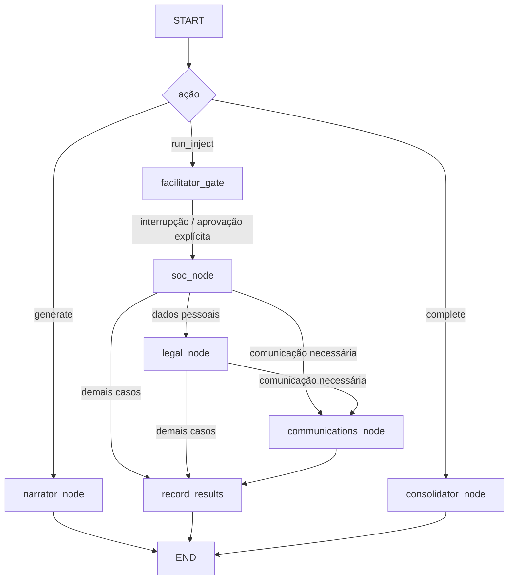

# Arquitetura CyberSim AI

## Componentes

- **Streamlit:** interface pt-BR, chama somente os endpoints REST e não implementa persistência nem regras transacionais.
- **FastAPI:** autenticação, autorização, validação Pydantic, escopo de tenant e composição dos serviços. Swagger em `/docs`.
- **Serviços:** aplicam as transições de exercícios, persistem decisões/execuções e produzem relatórios.
- **SQLAlchemy/Alembic:** modelo transacional relacional; PostgreSQL em implantação e SQLite em teste/local.
- **Camada LangChain:** `LLMProvider` desacopla MOCK e OpenAI-compatible. `ChatPromptTemplate` compõe instruções; `with_structured_output` valida schemas Pydantic.
- **LangGraph:** `MultiAgentOrchestrator` compila StateGraph tipado, roteia agente por inject, grava checkpoint e interrompe no nó de aprovação humana.
- **Analytics:** consultas SQLAlchemy para modelo transacional e geração independente de tabelas dimensionais/fatos em CSV.

## Grafo multiagente

O `thread_id` é o ID do exercício. PostgreSQL usa `PostgresSaver`; execução SQLite usa `MemorySaver`. A ação HTTP de liberar inject exige papel `admin`/`facilitator` e passa aprovação humana explícita ao checkpoint. A liberação é serial e respeita a ordem dos injects. Cenários podem ser regenerados antes do exercício começar; ao iniciar, a versão gerada fica congelada.

## Agentes e minimização

1. Narrador recebe contexto empresarial necessário para cenários.
2. SOC recebe o inject e ativos/acontecimentos pertinentes.
3. LGPD só é chamado pelo grafo quando o inject indica possível dado pessoal.
4. Comunicações só é chamado quando o inject ou facilitador solicita; só cria rascunho.
5. Consolidador recebe cenário, eventos, decisões e resultados do exercício.

Todos recebem JSON de usuário como dado não confiável; não há ferramentas de shell, navegador, e-mail ou infraestrutura. Saídas são Pydantic e revisáveis por humanos.

## Modelo de dados

`companies`, `users`, `participants`, `scenarios`, `scenario_injects`, `exercises`, `exercise_objectives`, `inject_events`, `decisions`, `agent_runs`, `findings`, `action_items`, `communication_drafts`, `objective_assessments`, `audit_logs`, `regulatory_references` e `business_calendar`. Filhos do exercício guardam `company_id` e `exercise_id` para validação de escopo e análises.

## Transação e operação

`app.main` cria a aplicação FastAPI e inicializa schema para facilitar o modo demonstração. Para evolução do schema use Alembic. O seed é idempotente para dados demonstrativos. Recomendação para produção: migração explícita antes da inicialização, PostgreSQL, segredo gerenciado, TLS, backup testado e métricas/logs centralizados.
